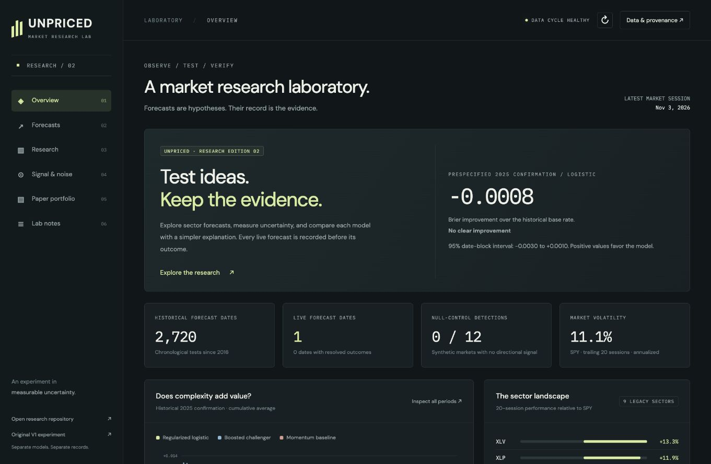

# UNPRICED · Research edition 02

A market research laboratory built to distinguish forecasting evidence from noise.

**Site:** https://prototypeversions.github.io/UnpricedZ/

Read the [first evaluation and launch checks](docs/FIRST_REVIEW.md). The initial models have not demonstrated a forecasting edge over the simple baseline.

The [registered upgrade program](docs/RESEARCH_PROGRAM.md) adds isolated macro-vintage, nested-selection, refit-cadence and frozen pretrained comparisons. It preserves the official live experiment. See the [two-lab strategy](docs/MULTI_LAB_STRATEGY.md) and [read-only cross-review brief](docs/CROSS_REVIEW_BRIEF.md) for the proposed UnpricedHub comparison layer.

The [first upgrade-program results](docs/PROGRAM_REVIEW_2026-11-04.md) are available: 24 tests passed; return-direction improvement is unproven; drawdown merits a stronger-baseline comparison. Macro data awaits credential verification.

This is a new, independent experiment. [The original UNPRICED V1](https://github.com/PrototypeVersions/Unpriced) is unchanged. Its forecasts and returns do not belong to this version.

## What works

- Five-session sector-relative forecasts against SPY, from **next session open through fifth session close**.
- Constant-50%, historical-base-rate, momentum, raw logistic, calibrated logistic and boosted comparisons. No adaptive ensemble.
- A separate five-session daily-variance forecast: EWMA baseline and a HAR-style regression.
- Chronological quarterly evaluation, purged label boundaries, separate calibration, paired date-block uncertainty and a prespecified 2025 confirmation period.
- Synthetic null, weak-signal and moderate-signal controls, using the production feature/model/evaluation pipeline across fixed seeds.
- Immutable prospective forecasts and resolutions; actual publication timestamps, exact feature rows, archived input vintages, model artifacts and source hashes.
- A predeclared historical/prospective reference-return paper policy with costs and fixed exits.
- Responsive, buildless website: overview, forecasts, research, signal/noise controls, paper portfolio, and lab notes.
- GitHub Actions runs integrity tests and publishes daily data without relying on a local computer.

## Important boundaries

This is research, not a demonstrated trading edge. Historical Yahoo-adjusted data may incorporate revisions. The universe is nine legacy US sector ETFs, not an exhaustive stock universe or all modern sectors. Opening prices are adjusted **reference prices**, not executable broker fills. Daily variance is a daily-sampled proxy, not intraday realized variance. Every simulation failure or weak result remains visible.

The 2025 confirmation year was declared in configuration before the initial research run. Once inspected, it is not an untouched holdout for future model redesigns. There is no automatic promotion on a short winning streak.

## Run

Python 3.11, pinned dependencies:

```sh
pip install -r requirements.txt
python -m pytest -q
python -m unpriced controls
python -m unpriced research
python -m unpriced daily
```

`bootstrap` runs controls, historical research, and a prospective publication if its window is still open. A missed publication remains missed. Forecasting a historical date is never relabeled live.

## Automatic operation

`.github/workflows/lab.yml` attempts updates at 21:17, 22:17 and 23:47 UTC on weekdays. These redundant attempts accommodate DST and delayed free data. The NYSE calendar, 45-minute close buffer, and **next opening deadline** determine whether an official forecast is eligible. Later same-session runs preserve the first forecast.

The website is hosted from `site/` with GitHub Pages. Pages must use **GitHub Actions** as its source. The pipeline deploys the resulting site directly after committing records because pushes made by `GITHUB_TOKEN` do not launch another workflow.

A separate ChatGPT research review is scheduled for Sunday mornings, around 08:00 America/Chicago. It investigates failures, reviews evidence and prepares tested fixes or challenger proposals without silently promoting models.



## Repository map

| Path | Role |
| --- | --- |
| `unpriced/` | Data, features, models, controls, evaluation, live publication |
| `research_program/` | Registered development experiments, independent of the official live engine |
| `tests/` | Scientific and operational integrity checks |
| `config.json` | Frozen experiment specification |
| `records/forecasts/` | Append-only live snapshots |
| `records/resolutions/` | Append-only outcomes |
| `archive/inputs/` | Content-addressed compressed data vintages |
| `archive/models/` | Frozen quarterly live models and provenance |
| `archive/research/` | Historical predictions and reports |
| `archive/program/` | All upgrade-program attempts, selection audits, environments and predictions |
| `site/data/` | Current public presentation of actual results |
| `docs/` | Methodology, protocol, operating rules and change log |

Read [the methodology](docs/METHODOLOGY.md), [frozen protocol](docs/PROTOCOL.md), and [operations](docs/OPERATIONS.md) before making substantive changes.
