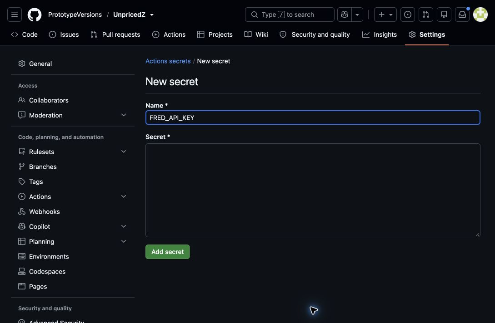

# Enable archived economic data

1. Create a free FRED account, then open **API Keys** and request a key for this application.
   The [official API-key page](https://fred.stlouisfed.org/docs/api/api_key.html) links to account setup.
   A suitable description is: "UNPRICED is a personal market research lab that uses FRED and
   ALFRED economic data, including historical vintages, to study sector returns, volatility,
   and drawdowns." Review and accept the provider's terms yourself if you agree.
2. Open [UnpricedZ Actions secrets](https://github.com/PrototypeVersions/UnpricedZ/settings/secrets/actions).
   Choose **New repository secret** (under Secrets, not Variables).
3. Set **Name** to `FRED_API_KEY`, paste the generated key into **Secret**, and click **Add secret**.
   Never commit the key, put it in an issue, or paste it into chat. The screenshot below has
   an intentionally empty secret field.
4. In [Actions → Registered research program](https://github.com/PrototypeVersions/UnpricedZ/actions/workflows/program.yml),
   choose **Run workflow** on `main`. Keep the pretrained option enabled for a complete combined
   report. A run queued before the key was saved does not receive the newly added repository
   secret; start a new run after saving it.

Success requires an actual API request and report verification. In `site/data/program.json`,
the macro status must be `available`, vintage coverage must be sufficient, and the macro
procedures must complete. A successful Actions badge alone is insufficient: the program can
finish other experiments while explicitly reporting a missing credential or data blocker.

The workflow retrieves historical publication vintages through FRED's Version 1 observations
endpoint with ALFRED real-time parameters. It does not replace them with today's revised
historical values. Only data and non-secret provenance are archived.

- [GitHub's repository-secret instructions](https://docs.github.com/en/actions/how-tos/write-workflows/choose-what-workflows-do/use-secrets)
- [FRED real-time/vintage documentation](https://fred.stlouisfed.org/docs/api/fred/realtime_period.html)
